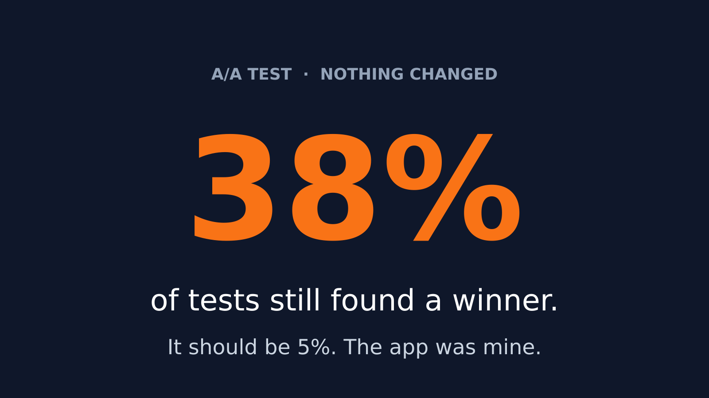
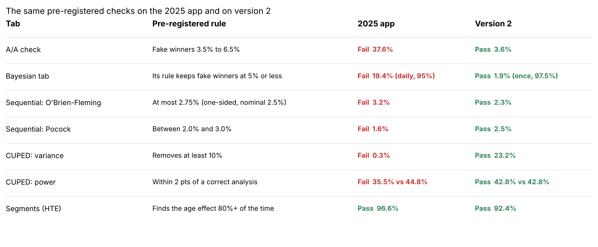
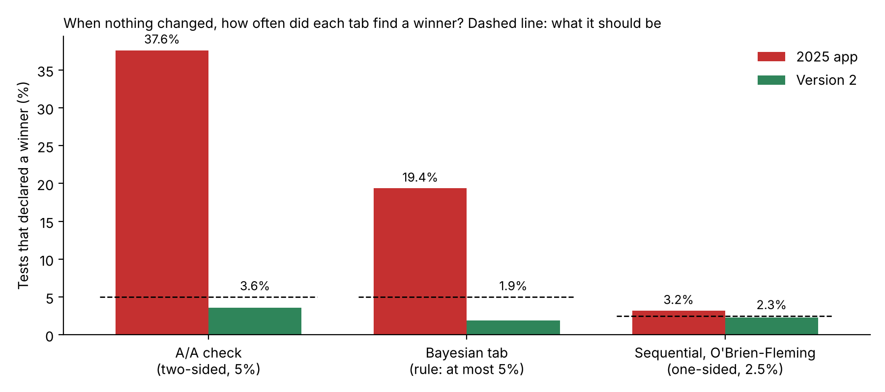
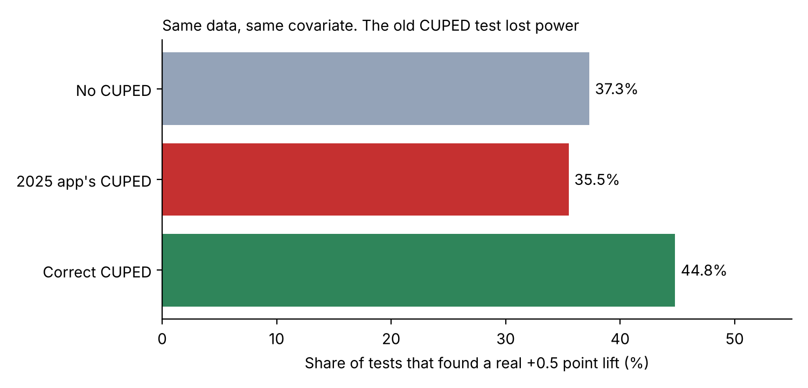

# I tested my own A/B testing app. It found a winner in 38% of tests where nothing changed.

## Last year I published an experimentation app and a post built on it. I checked both the way I checked Google's and Spotify's methods. Four of the five tabs I tested failed, and the post's advice was wrong.

*A companion to Big Tech measurement, rebuilt.*

In June 2025 I published a Streamlit app for A/B testing and a post that walked through it. The post started from a disappointing test, looked at it with CUPED and then by age group, found nothing each time, and concluded with "extremely high confidence" that the feature should be killed. This month I spent four posts testing other people's measurement methods against data where the right answer is known. It seemed fair to do the same to my own. The app found a winner in {H1} of tests where nothing changed, its Bayesian tab told readers that peeking was safe, and the feature the post told readers to kill had a real effect.

## What the app claimed

The app simulates users, splits them into two groups, and runs a different method on each tab. The A/A tab checks that the test doesn't find differences that aren't there. The Bayesian tab reports the probability that the new version is better and says this "naturally allows for checking results at any time without the “peeking problem”". The sequential tab draws stopping boundaries so you can look early. The CUPED tab uses each user's past behavior to remove noise. The HTE tab checks whether the effect differs by age.

The key idea of the app is a good one, and I still believe it. A simulator knows the true answer, so you can check whether each method finds it. That only works if the simulator itself is right.

## How I tested it

Before running anything, I wrote down a rule for each tab and committed it to git. I copied the app's own functions without changing them and ran each tab hundreds or thousands of times at its default settings: 20,000 users and a 5% conversion rate. One honest caveat: I had already spotted the first problem while reading the code, and the pre-registration says so.

*Figure 1. The same pre-registered checks on the 2025 app and on version 2.*

## The simulator had a thumb on the scale

The first check was the simplest. With the true lift set to zero, both groups get the same experience, so a test at the 5% level should declare a winner about 5% of the time. The app's A/A tab did it {H1} of the time, across 500 runs.

The cause was one line. To give the HTE tab something to find, I made the effect stronger for younger users by adding (40 - age) / 1,000 to the treatment group. The average user is 35, so that line adds about half a point of conversion to the treatment group in every simulation, even when the lift slider says zero. On a 5% base rate, that's a 10% lift that nobody asked for.

That bug also decides the old post. Every dataset the app could generate had a real effect of about half a point or more. The post's "high-confidence" decision to kill the feature was wrong inside the app's own world.

## Peeking is still peeking

For the next checks I removed the hidden effect, so they test the methods and not the simulator.

The Bayesian tab plots the probability that the new version is better, day by day for 14 days, with a line at 95%. If you ship the first time the curve crosses that line, you pick a winner that isn't there in {H2} of tests. If you only look on the last day, it's {H2final}. With flat priors, this probability moves almost one for one with the p-value, so checking it every morning has the same problem as checking a p-value every morning. Spotify showed this carefully, and [I checked their math on real data](https://medium.com/@faycal.zouine.usa/bayesian-a-b-tests-still-have-a-peeking-problem-i-checked-spotifys-math-on-real-data-934f47c20ef6) earlier this month. My own app had shipped the myth they were correcting.

*Figure 2. Share of tests that declared a winner when nothing changed. The dashed line is what each should be.*

The sequential tab was closer but still wrong. Its "O'Brien-Fleming" line used a shortcut formula that ends at exactly 1.96, and over five looks it let through {H3of} false winners where 2.5% was promised. Its "Pocock" line was really a Bonferroni split, which is too strict: {H3po}. Neither is a disaster, but both were labeled as something they weren't.

## CUPED made things worse

CUPED is the method I was proudest of in the old post. It removes the part of a metric that each user's past behavior predicts, so the treatment effect shows up against less noise. In the app it removed {H4a} of the variance. The simulated "past engagement" was mostly the user's age plus noise, and it barely predicted anything.

So I gave it a covariate that does predict the outcome, a user's own activity in the four weeks before the test, with a correlation of {H4corr}. A correct CUPED analysis found a real half-point lift in {H4correct} of tests, against {H4raw} without CUPED. The app's version found it in {H4app}, worse than doing nothing. It ran the adjusted metric through a test that assumes a yes-or-no outcome, so it estimated the noise as if CUPED had never removed any.

*Figure 3. Share of tests that found a real half-point lift, on the same simulated data.*

## The one that held

The HTE tab works. At default settings, its regression found the age effect in {H5} of 500 runs. The old post reported no age effect, from a run whose settings I can no longer recover. That's the second lesson in this audit: a post that can't be rerun can't be checked.

## Version 2

I rebuilt the app. The simulator now gives each user their own propensity to convert, the lift slider is the true average effect, and the sidebar shows that truth, so every tab can be compared against it. CUPED uses past activity that actually predicts the outcome and a test that uses the adjusted metric's own variance. The sequential boundaries are computed properly, and the Bayesian tab now says plainly that peeking inflates errors, recommends deciding once at the end, and has a button that shows how often daily checking fools you.

Then I ran the same checks on it. The A/A check gives {V1}. The Bayesian tab's recommended rule gives {V2}, against {V2daily} for checking daily at 95%. O'Brien-Fleming gives {V3of} and Pocock {V3po}, both within their rules. CUPED removes {V4a} of the variance and finds a real half-point lift in {V4app} of tests, against {V4raw} without it. The age effect is found {V5} of the time. All five pass.

## Limits

Everything here is simulated. The checks show the methods do what they say on data that follows the simulator's rules, not that the simulator looks like your product. Real metrics are skewed, users come back over weeks, and novelty fades, which is where [the Spotify post](https://medium.com/@faycal.zouine.usa/bayesian-a-b-tests-still-have-a-peeking-problem-i-checked-spotifys-math-on-real-data-934f47c20ef6) found early stopping goes wrong.

## What I take from it

The mistake that matters most isn't a formula. The old post took three non-significant results and called that "extremely high confidence" that nothing worked. A non-significant test means the data can't tell. The confidence interval says how big an effect you can rule out, and that's the number a product team needs. The new app prints it next to every non-significant result.

The other lesson is the one I keep writing about other people's tools. Before you trust a testing tool, run it on data where nothing changed and count how often it finds something. It takes an afternoon. My own app would have failed that check in its first minute.

---

*App: [the experimentation lab](https://app-experimentation-platform-p4mcqhkrtw5q3f72yr2wrw.streamlit.app/). Code, the pre-registration and every check: [github.com/ZFayFay/streamlit-experimentation-platform](https://github.com/ZFayFay/streamlit-experimentation-platform), under `audit/`. The Bayesian peeking point is from Mattias Frånberg and Mårten Schultzberg at Spotify. CUPED is from Deng, Xu, Kohavi and Walker (2013). The sequential boundaries follow Lan and DeMets (1983). Any mistakes are mine, and this time I've checked for the ones I made last year.*
